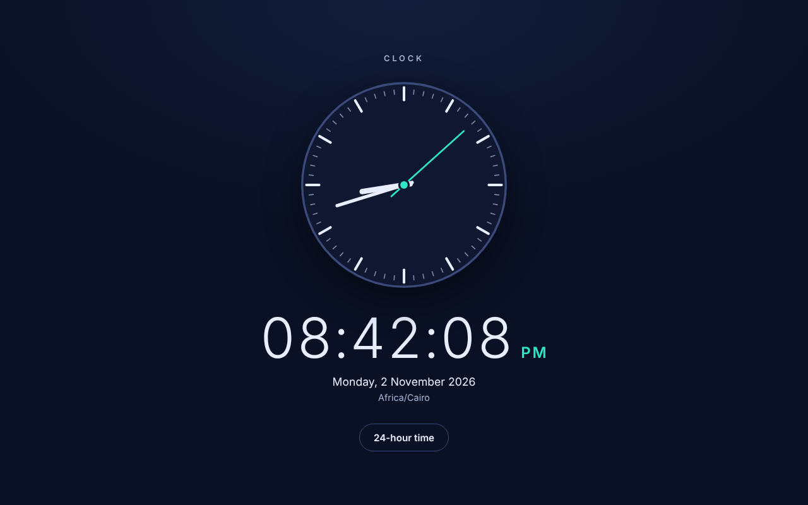
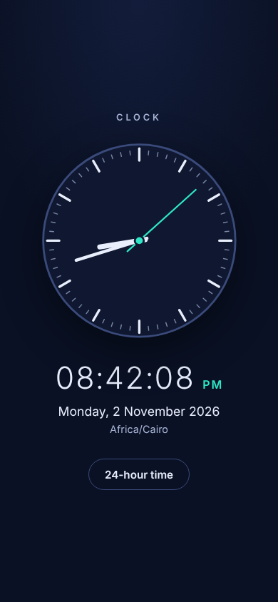

# Simple Clock

A small clock with an analog dial and a digital readout, built with plain HTML, CSS and JavaScript. No framework, no build step, no external assets.

Live demo: https://simple-clock-phi.vercel.app

| Desktop | Mobile |
| --- | --- |
|  |  |

## Features

- Analog dial (SVG) with hour, minute and second hands, plus a digital readout with seconds.
- 12-hour time with AM/PM by default; a toggle switches to 24-hour time and remembers the choice in `localStorage`.
- The date is formatted with `Intl.DateTimeFormat` in the visitor's own language and the local time zone name is shown.
- The browser tab title shows the current time, for example `08:42 PM · Clock`.
- Updates are scheduled for the start of each second, so the display does not skip or repeat seconds.

## Accessibility

- Semantic structure: a `<main>`, an `<h1>`, and the time inside a `<time>` element with a machine-readable `datetime`.
- The decorative dial is hidden from assistive technology. The time is deliberately not a live region, since announcing every second would be noise.
- The toggle is a real `<button>` using `aria-pressed`, with a visible focus ring. High contrast text, no motion apart from the hands moving.

## Run it

```sh
python3 -m http.server 5255
# open http://localhost:5255
```

It is a static site and deploys to Vercel with no build step.

## Verification

Checked in headless Chromium with Playwright and a fake clock set to a known time in the Africa/Cairo time zone: digital text, AM/PM, date, tab title, the 12/24-hour toggle, persistence after reload, no horizontal overflow and no console errors at 1280px and 390px widths. There are no unit tests.

## Known limitations

- Shows the visitor's local time zone only (no world clocks).
- It trusts the device clock, so a wrong system time shows a wrong time here.

## Notes

UI and code quality improvements were made with AI assistance (Claude, Anthropic), reviewed and verified by building and running the app.
